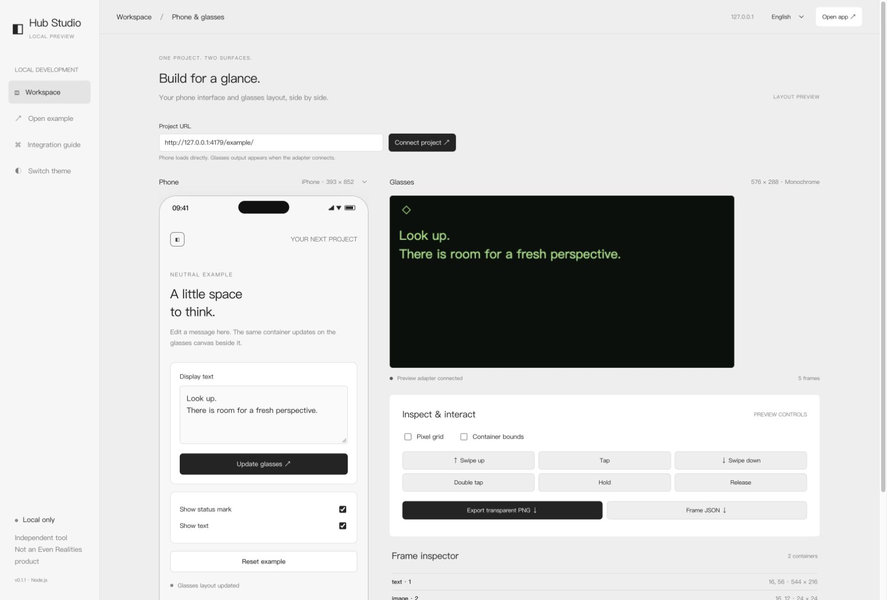

# Hub Preview Studio

English | [简体中文](./README.zh-CN.md)

A local developer workspace for previewing an Even Hub project's phone UI and
576 × 288 glasses layout side by side. **Independent community tool, not an
Even Realities product.** MIT licensed, Node.js 20+, zero runtime dependencies,
and no build step.



## Quick start

```sh
git clone https://github.com/zijiebuzhuang/hub-preview-studio.git
cd hub-preview-studio
npm start
```

Open `http://127.0.0.1:4177`. The default workspace runs a neutral, synthetic
example. To connect a project that is already running:

```sh
npm start -- --app http://localhost:5173 --port 4177
```

You can also download the `.tgz` from [Releases](https://github.com/zijiebuzhuang/hub-preview-studio/releases):

```sh
npm install -g ./hub-preview-studio-0.1.1.tgz
hub-preview-studio --app http://localhost:5173
```

The package is **not published to the npm registry**. Install the release file
or run the source; a registry install by package name is not available.

## Language

Choose **English** or **简体中文** in the top bar. Studio initially follows your browser language and remembers a manual choice on this browser. Changing language updates the workspace, guide and built-in example without reloading the connected project. Edited example text is preserved; external projects keep their own language.

## Phone preview

Enter any embeddable HTTP(S) project URL. The project keeps running on its own
server; Studio does not copy or proxy it. The workspace and built-in example
use neutral light/dark colors. The glasses preview retains monochrome green.

Choose a phone screen size, reload the iframe, or use **Open app** in the top
right to open the project separately. Phone screen sizes include a 44px status
bar and 34px bottom safe area. Preview chrome matches the example background;
external project colors are controlled by that project, not read across origins.

A project with `X-Frame-Options` or CSP `frame-ancestors` restrictions must permit
the Studio origin in its development configuration. Authentication, API access
and permissions still depend on the project and browser.

## Connect the glasses layout

Phone previews work without an adapter. Glasses layouts require an explicit
**development-only** bridge. Install this release in the project:

```sh
npm install --save-dev /path/to/hub-preview-studio-0.1.1.tgz
```

At the project's bridge creation point, choose the preview bridge only in
Studio during development. This example uses Vite's development flag:

```js
import { waitForEvenAppBridge } from '@evenrealities/even_hub_sdk';
import { createPreviewBridge, isStudioPreview } from 'hub-preview-studio/client';

const bridge = import.meta.env.DEV && isStudioPreview()
  ? createPreviewBridge()
  : await waitForEvenAppBridge();
```

Continue using `createStartUpPageContainer`, `rebuildPageContainer`,
`textContainerUpgrade`, `updateImageRawData`, and `onEvenHubEvent`. The bridge
models a limited SDK 0.0.16 API surface; it does not intercept SDK imports or
replace the full SDK. Obtain the official SDK separately. See the
[official reference](https://github.com/even-realities/everything-evenhub/blob/main/plugins/everything-evenhub/skills/sdk-reference/SKILL.md).

For custom renderers, publish frames directly:

```js
import { createStudioClient } from 'hub-preview-studio/client';

const studio = createStudioClient();
studio.publish({ nodes: [{
  id: 'message', type: 'text', x: 16, y: 48,
  width: 544, height: 224, text: 'Your project, your display.'
}] });
const unsubscribe = studio.onInput(event => console.log(event));
// On teardown: unsubscribe(); studio.dispose();
```

Studio adds `__hub_studio_origin` to the iframe URL. Messages are pinned to the
expected parent/iframe window and origin; the client targets a local HTTP(S)
Studio origin and never uses a wildcard postMessage target.

## Layout, input and exports

- Fixed 576 × 288 canvas, up to 12 text/list/image containers.
- Up to 2,000 characters per text container; 20 list items, 64 characters each.
- Images: inline PNG, one 0–15 grayscale value per pixel, or high-nibble-first
  packed gray4 through the bridge. PNG bytes are also accepted by the bridge.
  Remote image URLs are rejected.
- Gestures: tap (0), swipe up (1), swipe down (2), double tap (3), hold (9), and
  release (10). Events target the capture container, or the first text/list
  container. The project handles list selection and business responses.
- Export transparent PNG or normalized frame JSON. Debug bounds and the grid
  stay out of PNG exports. A **Save … again** link remains available after export.

Font metrics and native list behavior are approximate. Audio, Bluetooth, IMU,
location, permissions, background behavior and power consumption require the
official simulator or physical device. `getDeviceInfo()` returns `null`;
unsupported hardware methods throw. Preview storage exists only in page memory
and is cleared on reload.

## Local behavior

The server binds only to `127.0.0.1`, serves an explicit tool-asset allowlist,
and validates the Host header. It does not scan project files, read project
storage, call AI APIs, or provide a backend or telemetry. The iframe executes
the project's own code, which can still call its real services or use storage.
No SDK implementation, commercial font files or vendor artwork is bundled;
CSS uses available local fonts and system fallbacks. See [NOTICE](./NOTICE).

## Development

```sh
npm test
npm pack --dry-run
npm pack
```

The seven automated checks cover frame limits, source/origin pinning, text
replacement, bridge events/images/storage, server file isolation, language
preferences with unavailable storage, and translated dynamic messages. Desktop
validation also covers cross-port integration, text/image updates, gesture
round trips, light/dark appearance, 320/393 phone sizes, and actual PNG/JSON
exports. This is not physical-device validation.

See [CONTRIBUTING.md](./CONTRIBUTING.md) for changes and validation. Keep both
language versions consistent with behavior.

## License

[MIT](./LICENSE) © 2026 zijiebuzhuang.
