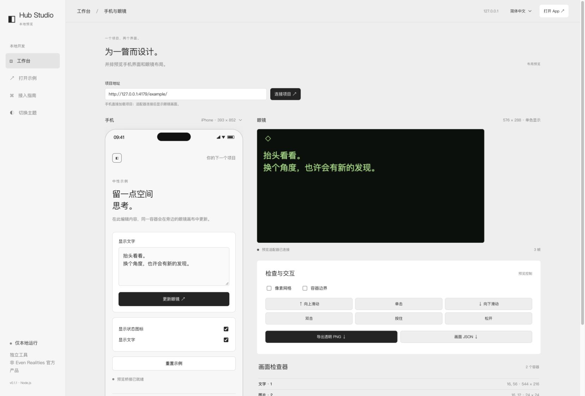

# Hub Preview Studio

[English](./README.md) | 简体中文

独立的本地开发工作台：在同一窗口预览 Hub 项目的手机界面和 576 × 288 眼镜布局。非 Even Realities 官方产品，也不替代官方 Simulator。Node.js 20+，零运行时依赖，无需构建。



## 安装与启动

从源码运行：

```sh
git clone https://github.com/zijiebuzhuang/hub-preview-studio.git
cd hub-preview-studio
```

无需安装运行时依赖，直接启动：

```sh
npm start
npm start -- --app http://localhost:5173 --port 4177
```

使用分发包：

```sh
npm install -g ./hub-preview-studio-0.1.1.tgz
hub-preview-studio --app http://localhost:5173
```

浏览器打开终端显示的 `http://127.0.0.1:4177`。不传 `--app` 时打开内置中性示例。默认不自动打开浏览器。工具只监听本机回环地址；不代理项目、不扫描项目目录、不部署服务、不访问 AI API。所有必要文件随 npm 包提供，源码包与 npm tgz 可独立于外部项目运行。

项目采用 [MIT 许可证](./LICENSE)，公开源码位于 [GitHub](https://github.com/zijiebuzhuang/hub-preview-studio)。可从 [Releases](https://github.com/zijiebuzhuang/hub-preview-studio/releases) 下载安装包。尚未发布到 npm 注册表，不能直接用包名从注册表安装。

## 界面语言

顶部语言选项支持 **简体中文 / English**。首次跟随浏览器语言，手动选择后保存在当前浏览器；存储不可用时仍可切换。语言切换覆盖工作台、接入指南与内置示例，不会重载已连接项目；示例中用户编辑过的文字保留，外部项目仍使用自己的语言。

## 工作台外观

工作台采用统一的字体栈、400 字重、188px 侧栏、64px 顶栏、32px 主内边距、24px 标题和 40px 双列间距；右上角 Open app 打开当前项目，主题切换位于侧栏（窄屏在页脚）。仅增加通用项目连接和开发检查控件。字体使用本机可用字体，不随包分发商业字体资产。

## 手机界面

输入任意可嵌入的 HTTP(S) 项目地址。工作台与内置手机示例默认采用中性黑白灰，手机状态栏与底部安全区使用示例背景色。眼镜画布保留设备单色绿色预览。支持 iPhone、Android、紧凑视口与重新加载；标注尺寸为手机屏幕尺寸，项目内容区扣除 44px 状态栏和 34px 底部安全区。外部项目的颜色由项目自行决定，工作台不会跨来源自动读取其背景。视口宽度超过面板时在手机列内水平滚动。项目仍由自己的开发服务器运行，工具不复制它。若项目设置了 X-Frame-Options 或 CSP frame-ancestors，需要在自己的开发配置中允许工作台来源。HTTPS 项目、登录、外部 API 的可用性仍取决于浏览器与项目本身。

手机预览运行项目自己的代码；项目如果包含真实服务调用或存储逻辑，其行为由该项目决定。工具没有自动读取或修改项目存储的能力。

## 接入眼镜画面

跨来源 iframe 不能自动读取项目内部状态。需要一个轻量开发适配器。在项目中安装工具包，再将原来的桥接创建位置改为：

```sh
npm install --save-dev /path/to/hub-preview-studio-0.1.1.tgz
```

```js
import { waitForEvenAppBridge } from '@evenrealities/even_hub_sdk';
import { createPreviewBridge, isStudioPreview } from 'hub-preview-studio/client';

const bridge = import.meta.env.DEV && isStudioPreview()
  ? createPreviewBridge()
  : await waitForEvenAppBridge();
```

显示代码继续调用 `createStartUpPageContainer`、`rebuildPageContainer`、`textContainerUpgrade`、`updateImageRawData`。输入通过 `onEvenHubEvent` 返回。只替换开发环境的桥接工厂；适配器不是完整 SDK 替代品，不自动拦截导入 SDK 的全局单例。`createPreviewBridge()` 是显式的布局模拟，`getDeviceInfo()` 返回 null，不伪装物理设备在线。模拟存储仅限当前页面内存，刷新即清空。麦克风、IMU、定位等能力明确不支持。

已模拟的 SDK 形状以本地 SDK 0.0.16 的类型与 [官方参考](https://github.com/even-realities/everything-evenhub/blob/main/plugins/everything-evenhub/skills/sdk-reference/SKILL.md) 核对。文字替换使用 `contentOffset` / `contentLength`；多页重建、列表和 z 层级可预览，但字体、字宽、原生滚动及系统退出对话框并非固件级模拟。

### 自定义渲染适配

不使用 SDK 容器时，可自行发布 frame：

```js
import { createStudioClient } from 'hub-preview-studio/client';
const studio = createStudioClient();
studio.publish({ nodes: [{
  id: 'message', type: 'text', x: 16, y: 48,
  width: 544, height: 224, text: 'Your project, your display.'
}] });
const unsubscribe = studio.onInput(event => console.log(event));
// 页面销毁：unsubscribe(); studio.dispose();
```

消息只接受指定 parent window 和本地 Studio origin。iframe 地址自动带 `__hub_studio_origin`，客户端使用其固定目标源，不使用 `postMessage('*')`。

## 画布与导出

- 固定 576 × 288；最多 12 个 text / list / image 节点。
- 文本最多 2000 字符/容器；列表最多 20 项、每项 64 字符。
- 图片接受内联 PNG（不加载任意远程图片）、逐像素 0–15 灰度或高位优先的 packed gray4。PNG 字节亦可通过 SDK 形状接口发送。
- 手势：单击0、上滑1、下滑2、双击3、长按9、释放10；派发到 isEventCapture 容器，否则首个文字/列表。列表选择与业务响应由项目自己处理。
- PNG 导出保留透明背景，调试边框和网格不进入导出；JSON 导出为已规范化的当前 frame。导出内容由用户主动触发下载；准备完成后保留“Save … again”链接，浏览器未自动保存时可手动点击。
- Canvas 字体仅近似系统字体，不承诺与 G2 固件像素完全一致。无真实音频、蓝牙、权限、后台或耗电模拟。没有遥测、账号、内置云端或第三方字体/图片请求。

## 开发与验证（源码目录）

```sh
npm test
npm pack
```

npm 包显式包含 bin、lib、web、examples、文档、LICENSE 和 NOTICE；不包含测试与 CI。源码仓库包含测试与 CI。测试覆盖来源校验、文本覆盖、数据边界、事件、图像格式、服务端目录隔离，以及语言偏好回退和动态文案。2026-10-30：7 项自动检查通过；独立安装目录启动、跨端口项目接入、文本/图像更新、手势回传、深色主题、320/393 视口及实际 PNG/JSON 导出完成桌面验证。透明 PNG 尺寸为 576×288，调试边框不进入导出。推荐在官方 Simulator 和 Android/iOS 真机补齐运行验收。
